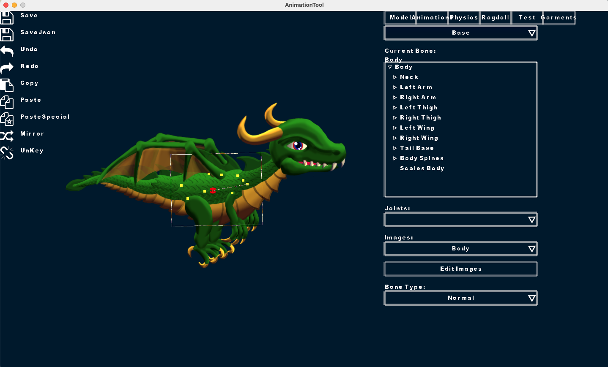

# AnimationTool

A visual editor for [AnimationLib](https://github.com/dmanning23/AnimationLib) content. Use it to build skeletons, keyframe animations, ragdoll/physics data, and garments, then save them as the XML or JSON files that AnimationLib loads in your MonoGame game.



## Related projects

| Project | What it's for |
|---|---|
| [AnimationLib](https://github.com/dmanning23/AnimationLib) | The runtime library that loads and plays the files this tool creates |
| [AnimationLib.Example](https://github.com/dmanning23/AnimationLib/tree/master/AnimationLib.Example) | A bare-bones game that loads a character and plays an animation. Start here once you have content |
| [AnimationTest](https://github.com/dmanning23/AnimationLib/tree/master/AnimationTest) | A more advanced sample with dynamic lighting, switching animations, garments, and physics overlays |

## Requirements

- **macOS.** The Open/Save dialogs use the native macOS file pickers, so the tool only runs on a Mac at the moment.
- .NET 8.0 SDK
- MonoGame 3.8 (`MonoGame.Framework.DesktopGL`). The MonoGame content tools are restored automatically on the first build.
- Compiling the lighting shader on macOS needs MonoGame's Wine setup for `mgfxc`, with `MGFXC_WINE_PATH` pointing to it. See the [MonoGame docs](https://docs.monogame.net/) for setup.

## Building and running

```bash
dotnet run --project AnimationTool
```

You can also open the repo folder in VS Code and use the **AnimationTool** launch configuration in `.vscode/launch.json`. It builds first, then starts the tool. Change the `MGFXC_WINE_PATH` value in `.vscode/launch.json` and `.vscode/tasks.json` to match your machine.

## Workflow

1. **Create or open a model.** Use **File → New**, or **File → Open Model** to load an existing skeleton `.xml`. Image paths are resolved relative to the model file's folder, so keep your PNGs alongside it.
2. **Build the skeleton** in the **Model** tab: select bones, place joints and anchors, and use **Edit Images** to set each bone's image, normal map, and color mask.
3. **Animate** in the **Animations** tab: pick a bone and a keyframe time, then set rotation, translation, layer, flip, and ragdoll on/off.
4. **Add physics** in the **Physics** tab (collision circles) and the **Ragdoll** tab (ragdoll type, spring, gravity, weight transfer).
5. **Preview** in the **Test** tab: choose an animation and a playback mode, and drag the character around to see the ragdoll bones react.
6. **Save** with **File → Save** / **Save As** (XML) or **Save As JSON**. The model and the animations are saved as separate files.

To load animations for an existing model, open the model first, then use **File → Open Animation**.

### Garments

Garments are separate files that layer onto a skeleton, such as clothes, armor, or weapons. Use the **Garment** menu to create a new one or open an existing one, and edit it in the **Garments** tab. Each garment is saved to its own file, so a game can mix and match them at runtime with `Garment.AddToSkeleton()`.

### Editing

The menu in the corner has **Undo**, **Redo**, **Copy**, **Paste**, and **Paste Special**. Edits go through [UndoRedoBuddy](https://github.com/dmanning23/UndoRedoBuddy), so most changes can be undone.

## Using the output in a game

Add the saved files to your game's `Content` folder, then load them with AnimationLib. The skeleton goes first, because the animations refer to its bones:

```csharp
var character = new AnimationContainer();
character.ReadSkeletonXml(new Filename("MyCharacter/Model.xml"), renderer, Content);
character.ReadAnimationXml(new Filename("MyCharacter/Animations.xml"), Content);
character.SetAnimation("Walking", EPlayback.Loop);
```

For the rest of the per-frame update and draw code, see [AnimationLib.Example](https://github.com/dmanning23/AnimationLib/blob/master/AnimationLib.Example/Game1.cs).

## License

MIT. See [LICENSE](LICENSE).
